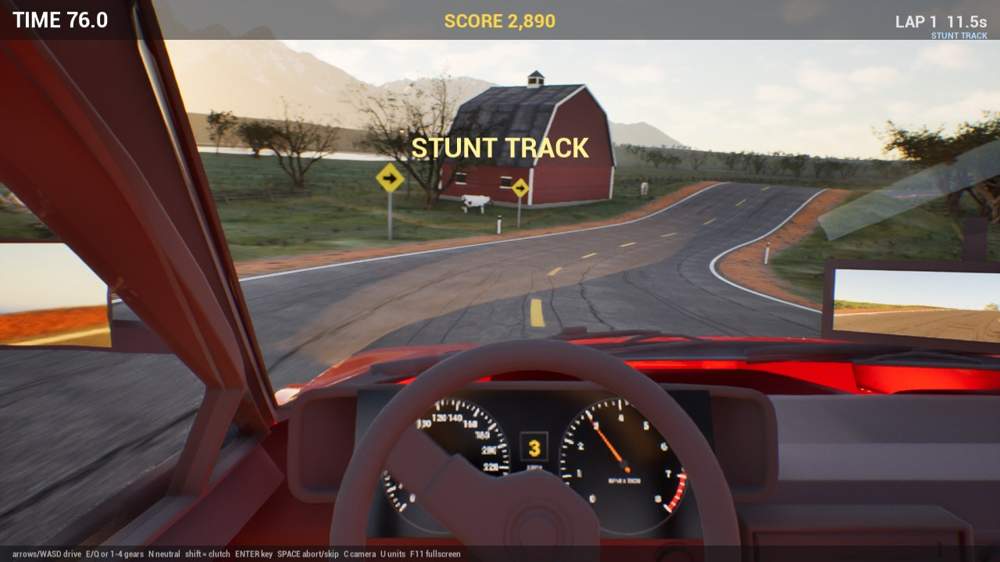
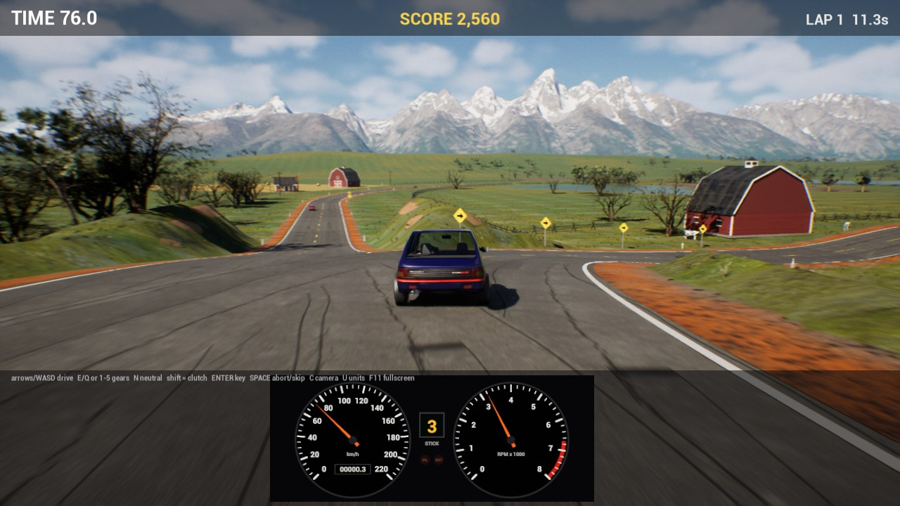
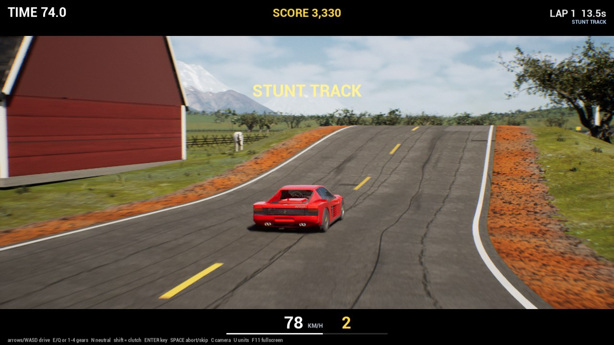
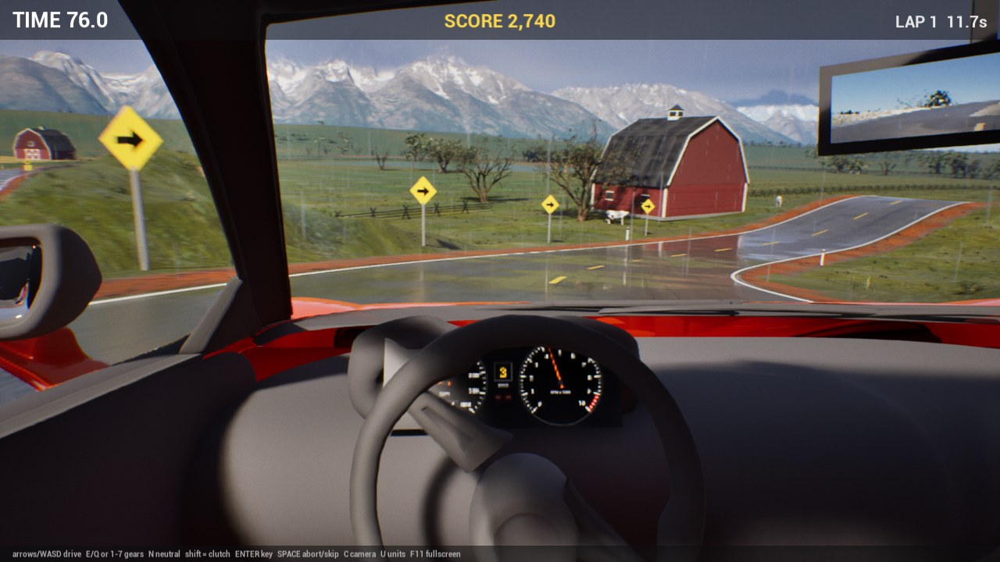
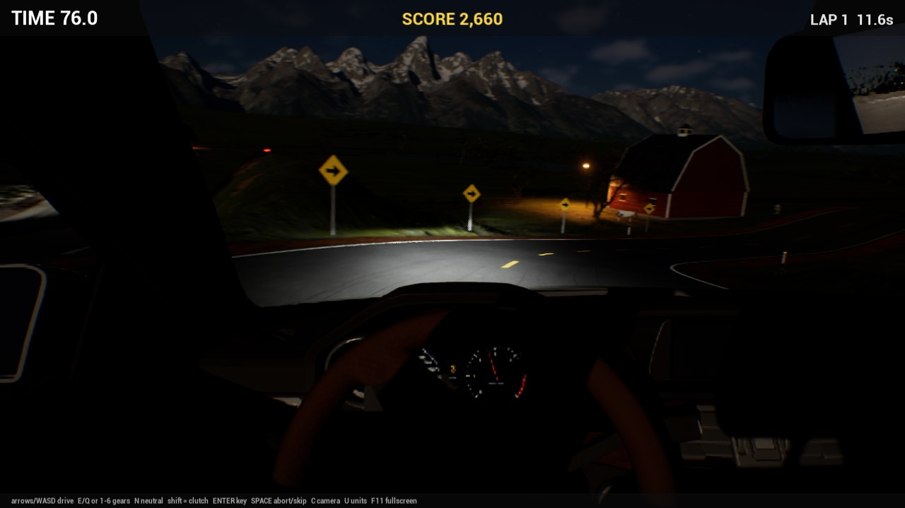
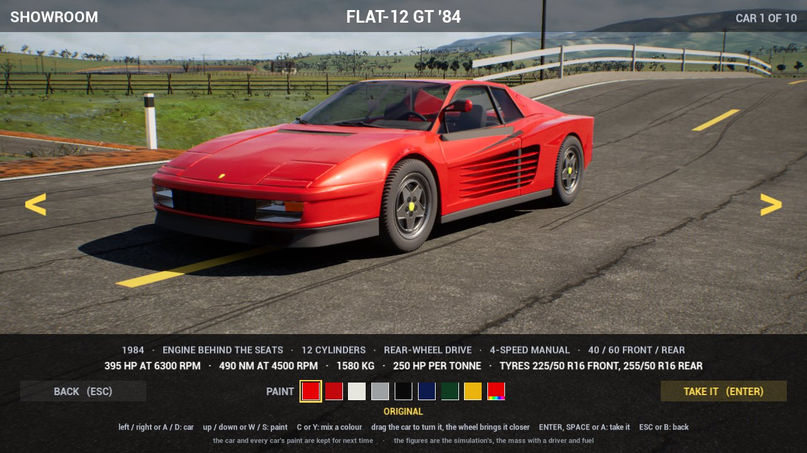
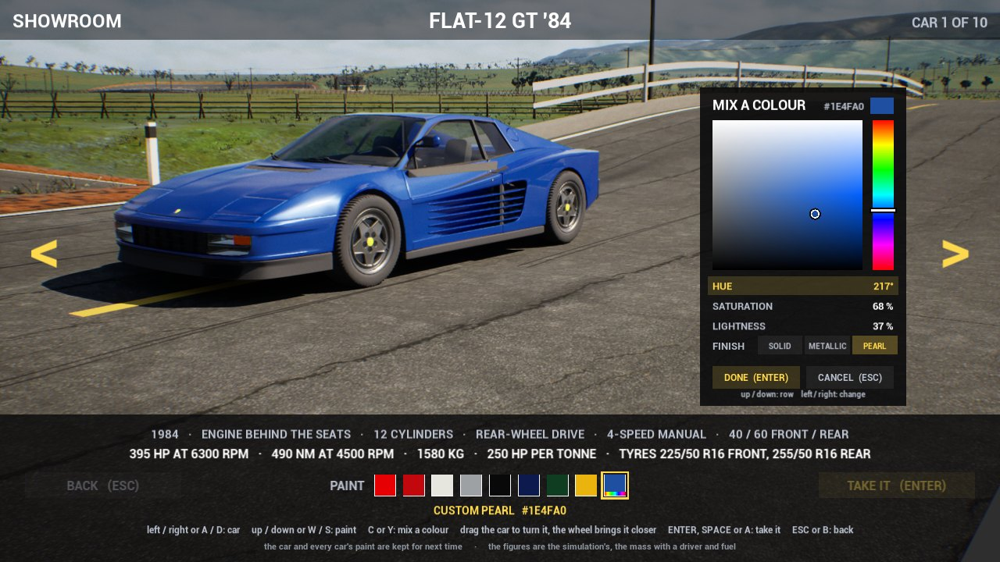

# GrudgeLap

**EN** · A homage to the 1989 arcade driving simulators, drawn as close to a photograph as a free game can be. Since
0.78 GrudgeLap runs on Unreal Engine 5 (Lumen with hardware ray tracing, Nanite, a physical sky and NVIDIA DLSS on RTX
cards), on the simulation it has had from the start. Ten cars to drive, each drawn by a real model with its own cabin
and simulated with its published weight, gearing and power and real engine recordings: a four-speed flat-twelve of
1984, a seven-speed V8 of 2012, a 4.5 flat-plane V8 of 2010, three hatchbacks of 1988-2003 (a front-wheel-drive
eight-valve 1.9, a four-wheel-drive two-litre turbo and a four-wheel-drive 3.2 V6), a 1.6 sixteen-valve hatchback of
2001, a 2.0 boxer coupe of 2013, and two everyday cars of Turkey's roads (a 1.4 estate of the 1990s and a 2.1
rear-wheel-drive diesel fleet saloon of the 2010s). A fork between a long *speed* route and a short *stunt* route with
an open drawbridge, a vertical loop and a banked 180, dips, traffic in both directions that keeps its distance,
checkpoints against the clock, knocks that bounce the car off (only a hard hit, or one too many, is a crash), an
instant replay with its own music after every crash, a hidden skid pad and the *grudge match*: the ghost of your best
lap races you on every lap after. The track follows the original's plan: the start at the foot of a bare hill with the
fork on its crest, a speed route that sweeps round the east side and passes under the open drawbridge, a stunt route
that jumps the speed route on that drawbridge, runs the loop and the banked 180 and crosses over itself. The scenery
is the one you remember, under a mountain range: a red barn, cows in the fields, a farmhouse, a gas station, yellow
signs that tip over when you clip them and a level crossing where a train really does come through; by day, at
sunrise, at dusk or at night, dry, overcast, wet or in the rain. You sit in the car's own cabin, reading working dials
through a steering wheel that turns as you steer, with the road behind you in the mirror, and in the rain the drops
bead on the windscreen until the wipers sweep them off; or follow the car from behind, or from far back through a
long lens, as a film would. You choose the car in the showroom, where it stands on
the track and the camera goes round it, in its own colour, one of seven others or one you mix yourself, solid,
metallic or pearl. Keyboard and gamepad, on Windows. Free, open source.

**TR** · 1989'un arcade sürüş simülatörlerine saygı duruşu; ücretsiz bir oyunun olabildiği kadar fotoğrafa yakın.
0.78'den beri GrudgeLap Unreal Engine 5 üzerinde çalışıyor (donanım ışın izlemeli Lumen, Nanite, fiziksel gökyüzü, RTX
kartlarda NVIDIA DLSS); simülasyon baştan beri aynı. Sürülebilen on araba, her biri gerçek modeliyle ve kendi
kabiniyle, yayımlanmış ağırlık, vites ve güç değerleriyle, gerçek motor kayıtlarıyla: 1984 flat-12 (4 vites), 2012 V8
(7 vites), 2010 4.5 düz krank V8, 1988-2003'ten üç hatchback (önden çekişli 1.9 8V, dört çeker 2.0 turbo, dört çeker
3.2 V6), 2001 1.6 16V hatchback, 2013 2.0 boxer coupe ve Türkiye yollarından iki gündelik araba (1990'ların 1.4
station'ı, 2010'ların 2.1 arkadan itişli dizel filo sedanı). Uzun *speed* ve kısa *stunt* rotaları (açık köprü, dikey
loop, eğimli 180°), çukurlar, iki yönlü trafik, süreye karşı kontrol noktaları, her kazadan sonra kendi müziğiyle
anlık tekrar, gizli skid pad ve *grudge match*: en iyi turunuzun hayaleti sonraki her turda sizinle yarışır. Manzara
hatırladığınız gibi: kırmızı ahır, tarlalarda inekler, çiftlik evi, benzin istasyonu, çarpınca devrilen sarı levhalar
ve hemzemin geçitten gerçekten geçen bir tren; gündüz, gün doğumu, alacakaranlık ya da gece; kuru, kapalı, ıslak ya da
yağmurlu. Arabanın kendi kabininde oturur, çalışan göstergeleri dönen direksiyonun içinden okur, arkanızdaki yolu
aynada görürsünüz; yağmurda damlalar ön camda birikir, silecekler süpürür; ya da arabayı arkadan, ya da uzaktan uzun
odaklı bir film kamerasıyla izlersiniz. Arabanızı
galeride seçersiniz: araba pistte durur, kamera çevresinde döner; kendi renginde, yedi hazır renkten birinde ya da
kendi karıştırdığınız düz, metalik ya da sedefli renkte. Windows'ta klavye ve oyun koluyla oynanır. Ücretsiz, açık
kaynak.



|  |  |
|---|---|
|  |  |
|  |  |

The name, track and sounds are our own. The ideas come from a game we loved; nothing from it is copied. The cars are
named by description; the models that draw them, the engine and tyre recordings and the scanned scenery are CC0 or
CC BY, each credited in [THIRD_PARTY.md](THIRD_PARTY.md).

Until 0.77 the game ran on Godot. That version is frozen (tag `v0.77.0`); what it had and this one does not have yet
(the crash scene with its damage, the 1989 look, the placed sounds and more) is being brought over, listed in section
12 of [docs/ISTERLER.md](docs/ISTERLER.md); the showroom and the paints came with 0.79, the windscreen's drops and
wipers with 0.80.

## Install

Download `GrudgeLap-Setup-x.y.z.exe` (per-user install, no admin rights) or the portable
`GrudgeLap-Portable-x.y.z.zip` (unzip anywhere, run `GrudgeLap.exe`; the `Engine` and `GrudgeLapUE` folders must stay
next to it) from **[Releases](https://github.com/korayorhun/GrudgeLap/releases/latest)**. The installer is
1.0 GB, the zip 1.2 GB, and the game takes 1.5 GB on disk. Nothing else has to be installed and Windows has nothing to
ask: the Visual C++ runtime the engine needs lies beside the game, and the game opens no network port, so the
firewall stays quiet. The package is not code-signed yet, so SmartScreen may say "unrecognized app": *More info → Run
anyway*. Scoop and winget packages wait for the 1.0 release.

Needs 64-bit Windows 10 or 11 and a DirectX 12 graphics card with Shader Model 6. A card with ray tracing gets
ray-traced reflections and shadows; an NVIDIA RTX card gets DLSS and DLSS Ray Reconstruction; any other card is
upscaled by the engine's own TSR.

One copy runs per computer: starting it again brings the running game to the front. The settings, the high scores,
the best laps and the updater's log are kept in `%LOCALAPPDATA%\GrudgeLap`; the first start takes over what an earlier
version kept (the Godot version's scores, best laps and choices included).

**Updates: only when you ask.** The game never looks for a new version or downloads anything by itself. The menu's
**CHECK FOR UPDATES** line (Esc; or `F10`) asks GitHub Releases for the latest version (the release's small
`update.json`). If there is one, the line becomes **DOWNLOAD AND INSTALL** with the version and its size, and one press
does the rest: the download (carried on where it stopped if the connection drops), its size and SHA-256 check, the
installation (the installed copy through its own installer, the portable copy by unpacking over itself) and the
restart on the new version. Enter stops a check or a download. What the updater is doing, and why when something
fails, is shown on that line and on the title screen, and every step goes to `update.log` in `%LOCALAPPDATA%\GrudgeLap`
(never a proxy's password); an update that does not install twice is left to you (the line then opens its release
page, and a later check still finds the versions after it), and so is a download your antivirus removes or blocks.
The installer asks for the room it needs before it touches the version you have, and a game started again while an
update is still being installed closes itself and lets the update finish. Nothing is sent anywhere.
A copy of 0.77 or older (the Godot game) updates itself to this version the way it always did, by itself, once. An
installed copy of that old game can stand still for up to a minute just before it closes (an antivirus reads the new
installer, a gigabyte, before Windows starts it): leave it, the installer follows.

## Play

Press **Enter** on the title screen and you are off. Before that, **left / right** picks the car, **1 / 2 / 3** the
gearbox (automatic at first), **H** the weather and **L** the hour; your choices are remembered. **Down** opens the
showroom: the car stands on the track and the camera goes round it (drag to turn it yourself, the wheel brings it
closer); left / right step through the cars, up / down through the paints, **C** mixes a colour of your own (hue,
saturation, lightness; solid, metallic or pearl), Enter takes the car with every paint you chose, Esc leaves them.
Each car keeps its paint. A crash shows a replay and puts you back at the last return point; Enter turns the key
again.

| Key | Action |
|---|---|
| Arrows / WASD | steer, throttle, brake |
| 1-4 (up to 1-7, by the car), N, R | gears (R only when stopped) |
| E / Q | shift up / down |
| Shift | clutch (only in *stick + clutch* mode: you can stall) |
| Enter | turn the ignition key (start, and after every crash) |
| Space | skip the instant replay / give up an off-road excursion |
| C | the camera: the driver's seat, behind the car, the film view (remembered) |
| U | km/h / mph (remembered) |
| Down / S (title screen) | the showroom: choose the car by sight, and its paint |
| Esc | the menu: continue, new game, car (opens the showroom), paint, camera, DLSS mode (off, DLAA, quality, balanced, performance, ultra performance; TSR's modes on a card without DLSS), DLSS Ray Reconstruction, weather, light, units, full screen, frame rate, **check for updates**, **quit** (the game stands still and silent while it is open; keys, gamepad or mouse) |
| F5 | new game |
| F6 | the frame rate under the clock (remembered) |
| F9 | attract mode (the scripted driver drives) |
| F10 | check for updates |
| F11 | full screen |
| F12 | screenshot |
| M (title screen) | open the replay music folder |

A gamepad works too: the left stick steers, the right trigger is the throttle and the left the brake, RB / LB
shift (on the title screen they step through the gearboxes), X is the clutch, A starts, B skips, Y switches
the camera, Back opens the menu, and the d-pad stands in for the stick and the pedals. On the title screen the d-pad's
down opens the showroom; there A takes the car, B leaves, Y mixes a colour.

Rules, from the cabinet's own operator options: 90 s on the clock, +45 s at the checkpoint and at the lap,
10 s off road and you are put back, wrong way does not count, traffic is solid. The stunt route wants about
60-80 mph for the open drawbridge and at least 60 for the loop. A hard left at the start line takes you
to the skid pad, as in the original; donuts there cost nothing. A sign only tips over; a barn, a tree, a bridge pier
or the train at the level crossing is a crash.

**Grudge match.** Your best lap is recorded pose by pose and saved, for each car. From then on its ghost drives every
lap with you; beat it and the new lap becomes the ghost.

**High scores.** The ten best credits are kept, and a score that makes the table asks for three initials
at the end of the credit, as the cabinet did (up and down turn the letter, Enter takes it). The table
ships with ten names to beat.

**Your own replay music.** Put a file named `replay.ogg` or `replay.wav` into `%LOCALAPPDATA%\GrudgeLap\music\`
(**M** on the title screen opens the folder) and the instant replay plays it instead of the built-in tune. The game
itself ships only its own music, so whatever you put there stays on your machine. A tune the Godot version was given
is still found where that version kept it.

**Weather and light.** Clear daylight by default. Clear, overcast, a wet road, rain or random (a draw for every
credit); day, sunrise, dusk, night or random. A wet road is dark and mirror-like and takes about a third of the grip:
brake earlier, turn in gentler, and mind the loop. At night the cars, the train and the farms have their lamps on.

## Build from source

Needs Unreal Engine 5.8 (the scripts look in `C:\UE\5.8`; set `UE_ROOT` for another), Visual Studio with the C++
workload, the .NET 8 SDK, Python 3 with numpy and Pillow, and [Inno Setup 6](https://jrsoftware.org/isinfo.php) for
the installer. The level is generated: [unreal/README.md](unreal/README.md) has the steps (the simulation core, the
world's export, the scans, the DLSS plugin, the level). Then:

```powershell
dotnet test physics.tests/GrudgeLap.Physics.Tests.csproj   # the feel checklist, headless
./tools/package.ps1                                        # tests, native libraries, build, cook, stage -> build/unreal, one hidden start
./tools/release.ps1 -Version 0.78.0 -NoStores              # stamp, package, installer, zip, update.json, tag, GitHub release
```

Automated runs (screenshots, checks) take the game's `-Glp…` switches, listed in [unreal/README.md](unreal/README.md);
`-RenderOffScreen -NoSound` keeps a run off the screen and silent.

## How it is made

- `physics/` — the simulation, with no engine dependency: raycast-wheel rigid body at 240 Hz, Pacejka-style tyres,
  torque-curve engines (flat-twelve, two V8s, the fours, a five, two turbo fours with their boost lag, a VR6, a boxer
  four and a turbodiesel with its governor), front-, rear- or four-wheel drive (a centre differential with a viscous
  coupling, or an on-demand coupling to the rear axle, and a differential per axle: open, clutch-type or Torsen),
  speed limiters where the real cars have them, clutch lock/slip with a launch assist, gearboxes, the track as a graph
  of road frames built by a turtle API (loop, drawbridge, banked curve, overpass, dips), the wear of the road, a
  ground field that gives the terrain its embankments and cuttings, traffic drones, the rules of a credit, the
  best-lap recording, the high-score table, and a scripted driver that threads the traffic.
- `physics.native/` — the same simulation as a native library with a C interface (NativeAOT; the `glp_*` functions in
  `include/grudgelap_physics.h`), which the game loads: `GrudgeLap.Physics.Native.dll` needs no .NET where it runs.
- `physics.tests/` — the feel checklist as numbers: 0-60, top speed (every car against its published figures),
  braking, stall, launch, the loop's minimum speed, the drawbridge window, the banked 180, the spin, grass, jumps in
  top gear, scripted laps on both routes with and without traffic and at any frame rate from 20 to 144 fps, drone
  collisions, the ghost, the skid pad, the ground and the props.
- `audio/` — the engine voice: real recordings cut into their firing pulses (`tools/make-engine-bank.py`) and laid
  down again one per firing period of the simulated revs; the tyres' mix read from where each tyre is on its force
  curve; `audio.tests/` renders them offline and measures pitch, levels, spectra and clicks.
- `update.native/` — the updater as a native library with a C interface (`include/grudgelap_update.h`): the check,
  the resumable verified download and the hand-over to the installer or the unpack script, none of it unless the
  player asks. `update.tests/` runs it against an in-process stand-in for GitHub with faults injected.
- `native-runtime.props` — the patch of the .NET runtime that the two native libraries carry, pinned (the SDK's own
  newest can be one with a published fault).
- `unreal/` — the game: the `GrudgeLapUE` module (C++) runs the session on the simulation core and draws it; the
  level is generated by scripts from the world's export, CC0 photoscans (Poly Haven) and the cars' models. See
  [unreal/README.md](unreal/README.md).
- `installer/`, `tools/package.ps1`, `tools/release.ps1`, `tools/portable_zip.py` — the installer (Inno Setup), the
  packaging and the release.
- `game/` — the Godot version, frozen at 0.77.0: the source of what is still being brought over, and the tool that
  exports the world (track, buildings, placements) the Unreal level is built from. It also holds the updater's shared
  sources and the recordings.

Design notes in [docs/design.md](docs/design.md), the checklist in [docs/feel-checklist.md](docs/feel-checklist.md),
the owner's requests and their status in [docs/ISTERLER.md](docs/ISTERLER.md), what the research found in
[docs/research-notes.md](docs/research-notes.md).

## Support

Bug reports and ideas: [Issues](https://github.com/korayorhun/GrudgeLap/issues). If GrudgeLap made you
smile, a coffee via [GitHub Sponsors](https://github.com/sponsors/korayorhun) is appreciated.

## License

MIT. Third-party components and the provenance of the models, the scans and the recordings: [THIRD_PARTY.md](THIRD_PARTY.md).
