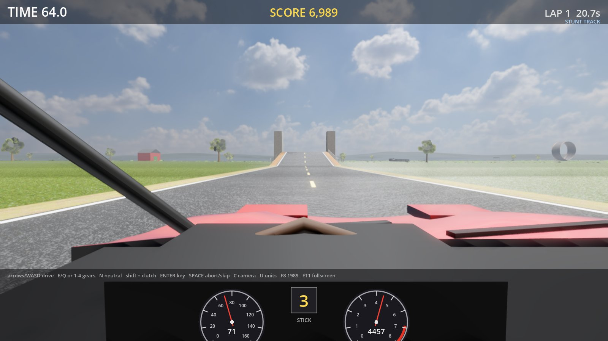
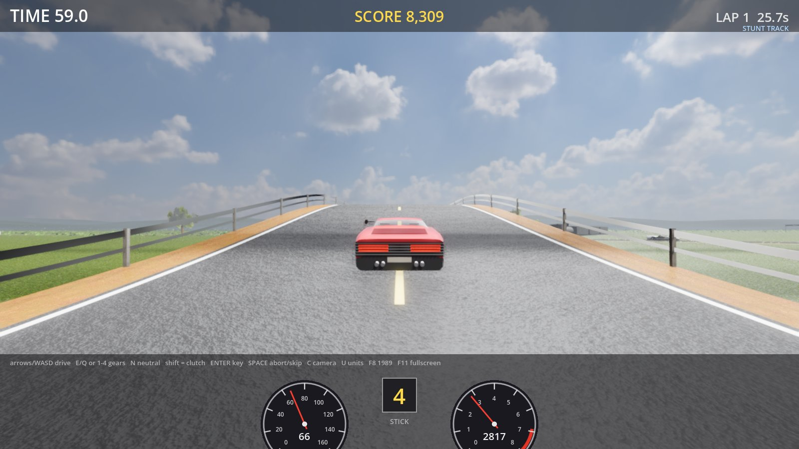
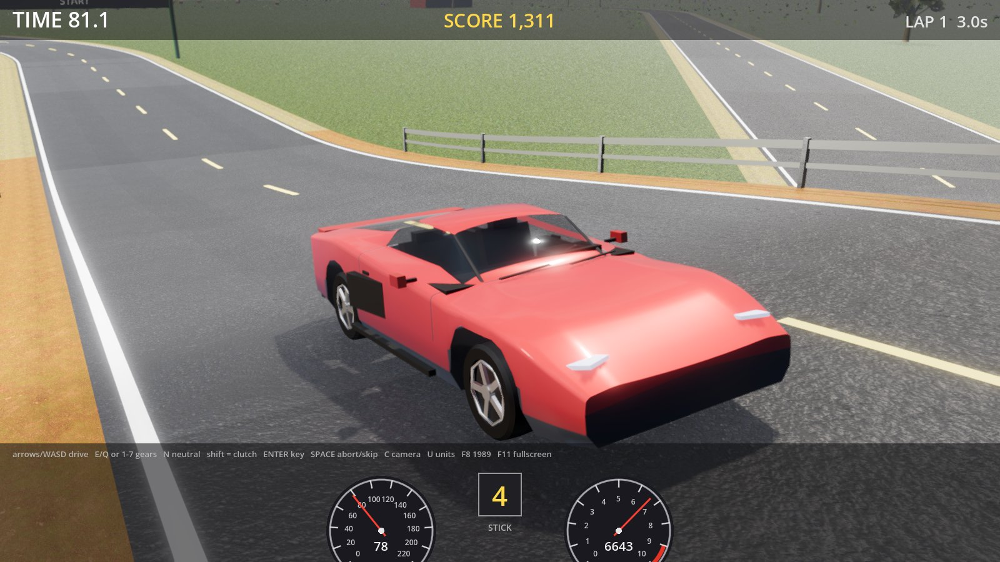
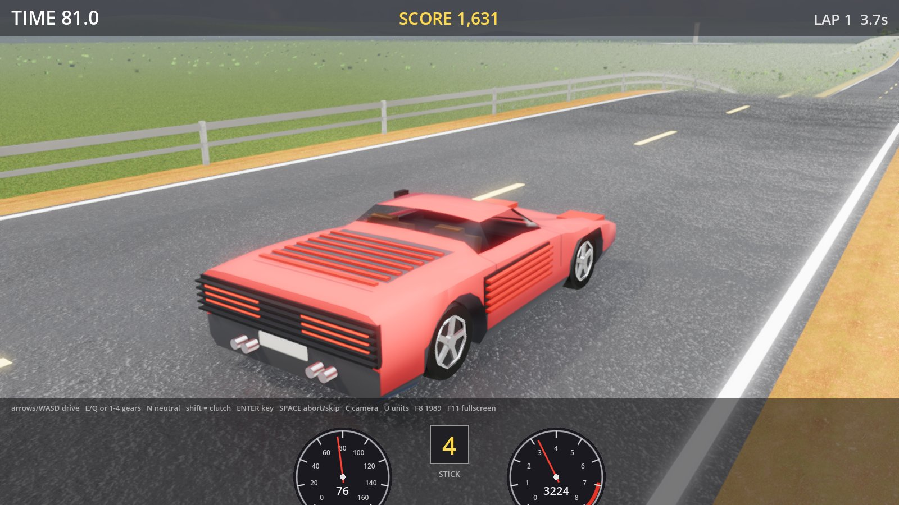
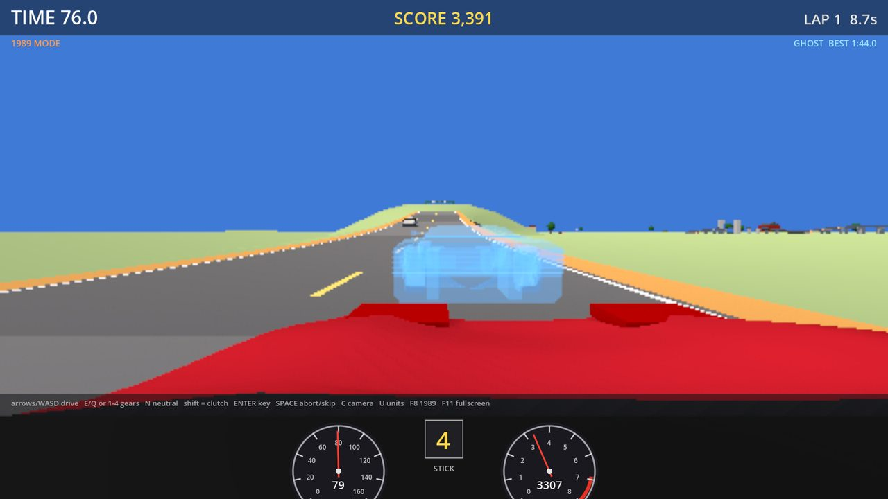
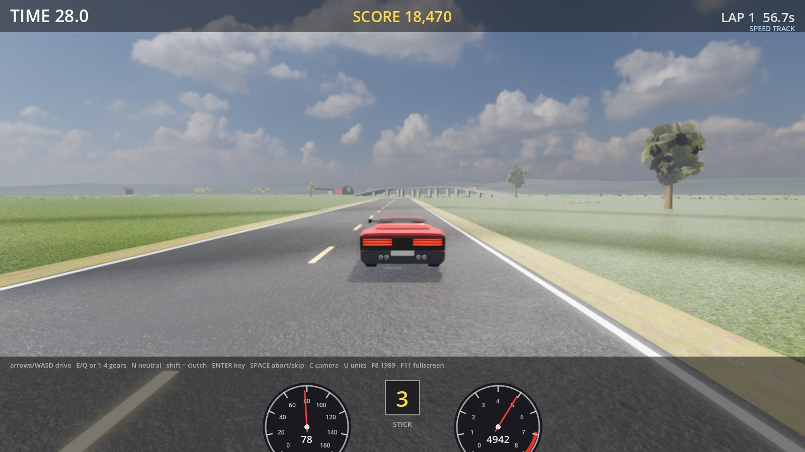

# GrudgeLap

**EN** · A homage to the 1989 arcade driving simulators. Two cars — a four-speed flat-twelve of 1984 and a
seven-speed V8 of 2012 with a sports exhaust, both with real engine recordings — a fork between a long
*speed* route and a short *stunt* route with an open drawbridge, a vertical loop and a banked 180, dips,
traffic in both directions, checkpoints against the clock, an instant replay after every crash, a hidden
skid pad, a "1989 mode" and the *grudge match*: the ghost of your best lap races you on every lap after.
The scenery is the one you remember: a red barn with "33" on its door, cows in the fields, a farmhouse after
the curve, a gas station, a camouflaged hut, yellow signs that tip over when you clip them, sawhorses before
the stunts and a level crossing where a train really does come through. You sit in a leather-lined cabin,
reading working dials through a steering wheel that turns as you steer, with the road behind you in the
mirror, and the tyres squeal, howl and scrabble on gravel from real recordings. Keyboard-playable on Windows,
windowed or full screen. Free, open source, no assets copied from anywhere.

**TR** · 1989'un arcade sürüş simülatörlerine saygı duruşu. İki araba (1984 flat-12, 4 vites; 2012 V8, 7
vites, spor egzoz; gerçek motor kayıtları), uzun *speed* ve kısa *stunt* (açık köprü, dikey loop, eğimli
180°) rotaları, çukurlar, iki yönlü trafik, süreye karşı kontrol noktaları, her kazadan sonra anlık tekrar,
gizli skid pad, "1989 modu" ve *grudge match*: en iyi turunuzun hayaleti sonraki her turda sizinle yarışır.
Manzara hatırladığınız gibi: kapısında "33" yazan kırmızı ahır, tarlalarda inekler, virajdan sonra çiftlik
evi, benzin istasyonu, kamuflajlı kulübe, çarpınca devrilen sarı levhalar, stunt öncesi tahta bariyerler ve
gerçekten tren geçen bir hemzemin geçit. Deri kaplı bir kabinde oturur, çalışan göstergeleri siz
çevirdikçe dönen direksiyonun içinden okur, arkanızdaki yolu dikiz aynasında görürsünüz; lastik
ciyaklaması, patinaj ve çakıl sesleri gerçek kayıtlardan. Windows'ta
klavyeyle oynanır; pencere veya tam ekran. Ücretsiz,
açık kaynak.



|  |  |
|---|---|
|  |  |
|  | |

The name, track, cars and sounds are our own. The ideas come from a game we loved; nothing from it is
copied. The car names are descriptions, not makes or models; the engine and tyre recordings are CC0 (see
[THIRD_PARTY.md](THIRD_PARTY.md)).

## Install

[Scoop](https://scoop.sh) users: `scoop bucket add korayorhun https://github.com/korayorhun/scoop-bucket`
then `scoop install korayorhun/grudgelap` (portable; updates arrive through `scoop update`). A winget
package (`winget install KorayOrhun.GrudgeLap`) follows with the 1.0 release.

Or download `GrudgeLap-Setup-x.y.z.exe` (per-user install, no admin rights) or the portable
`GrudgeLap-Portable-x.y.z.zip` (unzip, run `GrudgeLap.exe`; `GrudgeLap.pck` and the
`data_GrudgeLap_windows_x86_64` folder must stay next to it) from **[Releases](https://github.com/korayorhun/GrudgeLap/releases/latest)**. The
package is not code-signed yet, so SmartScreen may say "unrecognized app": *More info → Run anyway*.

**Auto-update:** every start the game asks GitHub Releases for a newer version; if there is one it downloads
it in the background, checks its SHA-256 and, as soon as you are on the title screen (or the credit is over),
installs it (the installed copy silently, the portable copy by unpacking over itself) and restarts on the new
version, so an opened copy is always the latest. `F10` applies a ready update at once, or asks again. Nothing is
sent anywhere. Under `[update]` in `%APPDATA%\Godot\app_userdata\GrudgeLap\settings.cfg`, `auto=false` goes
back to only offering the update (then `F10` takes it) and `enabled=false` switches the check off.

Starts windowed (1600x900); `F11` toggles full screen. Needs a Vulkan-capable GPU (any from the last ten years).
One copy runs per computer: starting it again brings the running game to the front.

## Play

Press **Enter** (or Space, or click) on the title screen and you are off. Before that, **left / right**
picks the car and **1 / 2 / 3** the gearbox (automatic at first; your last choice is remembered). A crash
shows a replay and puts you back at the last return point; Enter turns the key again.

| Key | Action |
|---|---|
| Arrows / WASD | steer, throttle, brake |
| 1-4 (1-7 in the V8), N, R | gears (R only when stopped) |
| E / Q | shift up / down |
| Shift | clutch (only in *stick + clutch* mode: you can stall) |
| Enter | turn the ignition key (start, and after every crash) |
| Space | skip the instant replay / give up an off-road excursion |
| C | cockpit / chase camera |
| U | mph / km/h |
| F8 | 1989 mode: a third of the pixels, 20 frames a second, flat colours, synthesised engine and tyres |
| F9 | attract mode (the scripted driver drives) |
| F10 | check for / install an update |
| F11 | full screen |
| F12 | screenshot (saved under `%APPDATA%\Godot\app_userdata\GrudgeLap`) |
| F7 | graphics preset: high, medium, low (remembered) |
| F6 | frame-rate counter |
| F5 | new game |

A gamepad works too: the left stick steers, the right trigger is the throttle and the left the brake, RB / LB
shift (on the title screen they step through the gearboxes), X is the clutch, A starts, B skips, Y switches
the camera, Back starts a new game, and the d-pad stands in for the stick and the pedals.

Rules, from the cabinet's own operator options: 90 s on the clock, +45 s at the checkpoint and at the lap,
10 s off road and you are put back, wrong way does not count, traffic is solid. The stunt route wants about
60-80 mph for the open drawbridge and at least 60 for the loop. Somewhere off the speed route a sign
points to the skid pad; donuts there cost nothing. Cows and signs only complain when you hit them; a barn,
a tree, a sawhorse or the train at the level crossing is a crash.

**Grudge match.** Your best lap is recorded pose by pose and saved. From then on its ghost drives every lap
with you; beat it and the new lap becomes the ghost.

**High scores.** The ten best credits are kept, and a score that makes the table asks for three initials
at the end of the credit, as the cabinet did (up and down turn the letter, Enter takes it). The table
ships with ten names to beat.

## Build from source

Needs the .NET 8 SDK and [Godot 4.7.2 .NET](https://godotengine.org/download/windows/) with its export
templates (the Windows build via `winget install GodotEngine.GodotEngine.Mono` puts the editor where the
scripts look). Then:

```powershell
dotnet test physics.tests/GrudgeLap.Physics.Tests.csproj   # the feel checklist, headless
./tools/build.ps1                                          # tests + export -> build/GrudgeLap.exe
./tools/release.ps1 -Version 0.4.0                         # bump, build, installer, zip, tag, GitHub release, Scoop, winget
```

The installer needs [Inno Setup 6](https://jrsoftware.org/isinfo.php) (`installer/GrudgeLap.iss`).
Godot's editor opens the `game/` folder; the simulation lives in `physics/` with no engine dependency.
Automated runs (screenshots, checks) take a few switches after Godot's `--`, listed in
[docs/design.md](docs/design.md); `--invisible` keeps the window off the screen and `--no-ghost` leaves the
best lap's ghost out of the picture.

## How it is made

- `physics/` — the simulation: raycast-wheel rigid body at 240 Hz, Pacejka-style tyres, torque-curve
  engines (flat-twelve and V8 specs), clutch lock/slip with a launch assist, gearboxes, the track as a graph
  of road frames built by a turtle API (loop, drawbridge, banked curve, overpass, dips), the wear of the road
  (a slow undulation and potholes in the wheel tracks that the wheels feel and the view draws), a ground
  field that gives the terrain its embankments and cuttings, traffic drones, the rules of a credit, the
  best-lap recording, the high-score table, and a scripted driver that threads the traffic.
- `physics.native/` — the same simulation as a native library with a C interface (NativeAOT; the
  `glp_*` functions in `include/grudgelap_physics.h`), for the Unreal Engine version: `dotnet publish
  physics.native -c Release -r win-x64 -o artifacts/physics-native` builds `GrudgeLap.Physics.Native.dll`,
  which needs no .NET where it runs.
- `physics.tests/` — the feel checklist as numbers: 0-60, top speed, braking, stall, launch, the loop's
  minimum speed, the drawbridge window, the banked 180, the spin, grass, jumps in top gear, scripted laps on
  both routes with and without traffic, drone collisions, the ghost, the skid pad, the ground and the props.
- `audio/` — the engine voice both versions play: real recordings cut into their firing pulses
  (`tools/make-engine-bank.py`) and laid down again one per firing period of the simulated revs;
  `audio.tests/` checks its pitch, clicks and silence (set `GRUDGELAP_AUDIO_DEMO` to a folder for
  listenable sweeps).
- `game/` — the Godot view: world generated from the track (terrain mesh from the ground field with a ring
  of wooded hills and a snow-capped mountain range round the horizon under a clear sky with drifting clouds,
  photo-textured road worn like a real one (patches of other asphalt, potholes, tar snakes, oil in the wheel
  tracks, faded lines, every stretch different), dirt shoulders, bridges with guardrails, the loop in its
  steel lattice, the drawbridge's white A-frame towers with cables, pad, grass tufts, trees from leaf cards,
  a wood beyond the fields, fields, textured buildings, the green fork gantry with its traffic light, the
  red checkpoint banner, signs, the train), lofted car bodies
  with rounded character lines, panel seams and a lined cabin behind tinted glass (leather dashboard,
  binnacle with live dials, a three-spoke wheel that turns with the steering, seats, slim A-pillars, a
  rear-view mirror with its own camera), a driver's-eye cockpit camera whose head sways with the car and
  a chase camera, HUD, engine, tyre (road roar, squeal, howl, screech, gravel) and V8 overrun-pop sounds
  from recordings over synthesised wind and bump thumps, the drones' engines and the train's steam and
  whistle placed in the world with Doppler shift (through the glass from the driver's seat), the shifter's
  clunk, crash recordings, a synthesised engine and squeal for 1989 mode, moo, sign clang, and the cabinet's
  chime, starter and jingles (a fanfare for a record lap, a tune at the end of the credit; no music while
  driving, as in the arcade), keyboard and gamepad, graphics presets, the high-score table with its entry
  of initials, updater. Design notes in [docs/design.md](docs/design.md), the checklist in
  [docs/feel-checklist.md](docs/feel-checklist.md), what the research found in
  [docs/research-notes.md](docs/research-notes.md).
- `unreal/` — the Unreal Engine 5 version: the same track and both cars, exported from the game, dressed
  with CC0 photoscans (Poly Haven) under Lumen, Nanite and a physical sky, and the whole game on the
  simulation through `physics.native`: title screen, gearboxes, keyboard and gamepad, traffic, ghost, train,
  HUD, instruments, mirrors, the high-score table and the same sound. Scripts rebuild the level, play it, drive it for tests, render stills and
  measure the frame rate; see [unreal/README.md](unreal/README.md).

## Support

Bug reports and ideas: [Issues](https://github.com/korayorhun/GrudgeLap/issues). If GrudgeLap made you
smile, a coffee via [GitHub Sponsors](https://github.com/sponsors/korayorhun) is appreciated.

## License

MIT. Third-party components and the provenance of the engine and tyre recordings: [THIRD_PARTY.md](THIRD_PARTY.md).
